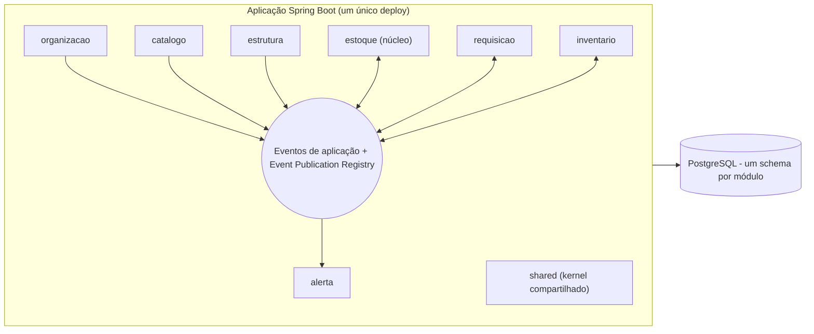
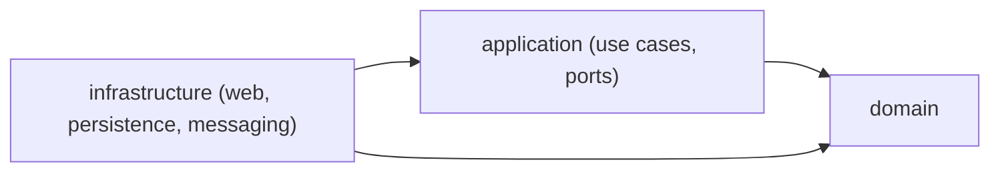
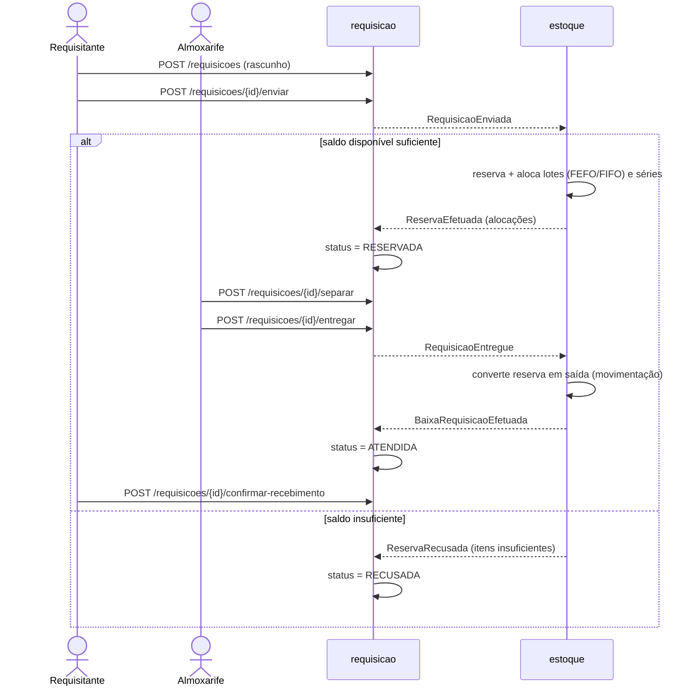
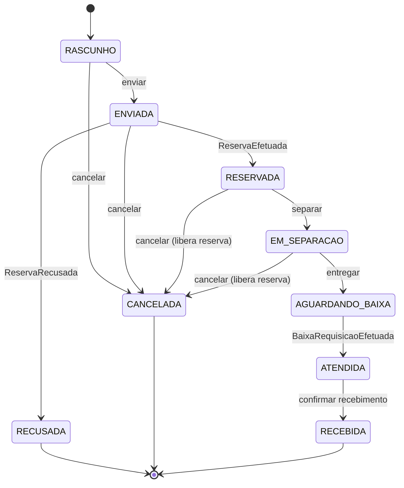
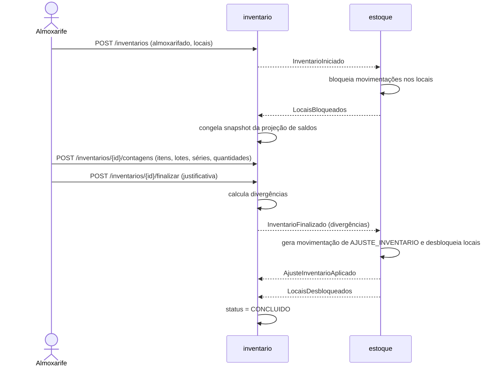

# Spec — Sistema de Almoxarifado

> Especificação técnica: descreve **como** o sistema será construído para atender ao [intent.md](./intent.md).
> Status: rascunho v1 · Última atualização: 2026-11-09

> Implementação operacional em 2026-11-12: consulte [BACKEND_MVP.md](BACKEND_MVP.md)
> para rotas executáveis, workflows, validação e limites. Esta especificação inclui
> recursos adicionais ainda não entregues; o backend atual não representa toda a
> especificação concluída.

---

## 1. Visão geral da arquitetura

| Aspecto | Decisão |
|---------|---------|
| Estilo arquitetural | **Monólito modular** |
| Modularização | **Spring Modulith** (módulos de aplicação verificados em teste) |
| Comunicação entre módulos | **Exclusivamente por eventos** (assíncronos, após commit) |
| Organização interna de cada módulo | **Clean Architecture** (domínio → aplicação → infraestrutura) |
| Modelagem | **DDD** — cada módulo = um *bounded context* |
| Linguagem / Framework | Java 21+ · Spring Boot (versão estável compatível com Spring Modulith) |
| Banco de dados | **PostgreSQL** — um banco, **um schema por módulo** |
| Migrações | **Flyway** (scripts separados por módulo) |
| Containerização | **Docker** + **Docker Compose** para app e PostgreSQL |
| Imagem da aplicação | imagem Java multi-stage com JDK 21 e artefato Spring Boot |
| API | REST · JSON · versionada em `/api/v1` |
| Documentação da API | springdoc-openapi (**Swagger UI**), agrupada por módulo |
| Segurança | Spring Security · **Keycloak** · JWT · RBAC |
| Autenticação | Keycloak como identidade e provedor de tokens OIDC/OAuth2 |
| Front-end | **Angular 20** + standalone components + lazy loading |
| Organização do front | estrutura por `features`, `shared`, `core` e `layouts` |
| Multi-tenancy | Schema compartilhado com coluna `organizacao_id` *(ver intent §12)* |
| Testes | JUnit 5 · Spring Modulith Test · Testcontainers (PostgreSQL) · ArchUnit · MockMvc · Jasmine/Karma |



### 1.1 Princípios inegociáveis

1. **Nenhum módulo chama beans de outro módulo.** A integração acontece só por eventos publicados.
2. **Nenhum módulo lê tabelas de outro módulo.** Cada módulo tem seu schema e não cria FKs para outros schemas.
3. Quando um módulo precisa de dados de outro, ele mantém uma **projeção local** (*read model*) atualizada pelos eventos.
4. O **domínio não depende de framework** (sem Spring, sem JPA nas classes de domínio).
5. A estrutura de módulos é **verificada automaticamente** em teste (`ApplicationModules.verify()`). Uma violação quebra o build.

### 1.2 Docker e Flyway no ambiente de execução

A aplicação será executada em containers para padronizar desenvolvimento, testes e implantação. O ambiente local e o de CI/CD devem usar o mesmo padrão, reduzindo diferenças de configuração.

#### 1.2.1 Estrutura de execução com Docker

O ambiente completo inclui a aplicação, PostgreSQL e o Keycloak, permitindo autenticação real em desenvolvimento e testes.

A configuração executável está em [`docker-compose.yml`](../docker-compose.yml).
Os serviços são `postgres`, `postgres-init`, `keycloak` e `app`. O PostgreSQL usa o
volume persistente `postgres_data`; o preparo idempotente cria o database separado
do Keycloak também em volumes já existentes. Scripts e realm são incluídos nas
imagens para compatibilidade com Docker Desktop e daemons Linux remotos.

As portas no host são `6432` (PostgreSQL), `8181` (Keycloak) e `8080` (API). Na rede
interna são `postgres:5432`, `keycloak:8080` e `app:8080`. O issuer permanece a URL
pública `http://localhost:8181/realms/almoxarifado`; o JWKS usa a URL interna no
profile `docker`. Health checks ordenam a inicialização dos serviços.

#### 1.2.2 Dockerfile

O [`backend/Dockerfile`](../backend/Dockerfile) usa Maven/JDK 21 para construir o
artefato e JRE 21 em execução, com usuário sem privilégios e health check de
readiness. Os testes com Testcontainers rodam antes, no host ou no CI, com
`mvn clean verify`; o build da imagem usa `-DskipTests`.

#### 1.2.3 Estratégia de migrações com Flyway

- Cada módulo terá sua própria pasta de migrações, mantendo organização e versionamento.
- O Flyway executa os scripts na ordem de versão, antes da aplicação subir totalmente.
- As migrações são idempotentes por versão e ficam no repositório junto ao código.
- O banco deve ser criado e ajustado automaticamente pelo container do PostgreSQL e pelas migrações do Flyway.

Exemplo de estrutura:

```text
src/
  main/
    resources/
      db/
        migration/
          shared/
            V1__create_tenant_tables.sql
          organizacao/
            V1__create_organizacao_tables.sql
          catalogo/
            V1__create_catalogo_tables.sql
          estrutura/
            V1__create_estrutura_tables.sql
          estoque/
            V1__create_estoque_tables.sql
          requisicao/
            V1__create_requisicao_tables.sql
          inventario/
            V1__create_inventario_tables.sql
          alerta/
            V1__create_alerta_tables.sql
```

#### 1.2.4 Regras do Flyway

- O nome do script deve seguir o padrão `V<versao>__descricao.sql`.
- Cada script deve ser independente e manter compatibilidade com versões anteriores.
- Mudanças de schema em produção devem ser feitas por migração nova, nunca por alteração direta de tabela no ambiente.
- A aplicação deve falhar cedo se a base não estiver sincronizada com as migrações esperadas.

#### 1.2.5 Ambiente local e de desenvolvimento

- `docker compose up --build` prepara o PostgreSQL, o Keycloak e a aplicação.
- `docker compose down -v` reinicia o ambiente limpo.
- O profile `docker` deve ativar configurações específicas para execução em container.
- Em desenvolvimento, o banco pode ser acessado via `localhost:6432`, a API via `http://localhost:8080` e o Keycloak via `http://localhost:8181`.

---

## 2. Segurança e autenticação

A autenticação da aplicação será centralizada no Keycloak, seguindo o padrão OIDC/OAuth2 com JWT. A aplicação Spring Boot atuará como Resource Server, validando tokens emitidos pelo Keycloak e autorizando acessos por perfil/role.

### 2.1 Fluxo proposto

1. O usuário acessa a interface ou o backend via um cliente autenticado.
2. O cliente solicita token no Keycloak.
3. O Keycloak valida credenciais e retorna um JWT.
4. A API Spring Boot valida o token com o issuer do Keycloak.
5. A aplicação consulta as roles/claims do usuário para decidir autorização.

### 2.2 Perfis e permissões

| Perfil | Descrição | Permissões principais |
|--------|-----------|----------------------|
| `ADMIN_PLATAFORMA` | administra organizações e configurações globais | criar organizações, supervisionar tenants, visualizar auditoria |
| `ADMIN_ORGANIZACAO` | administra a organização | configurar usuários, permissões e almoxarifados |
| `ALMOXARIFE` | operação diária do estoque | cadastrar itens, entradas, saídas, transferências e inventários |
| `REQUISITANTE` | solicita materiais | criar e acompanhar requisições |
| `GESTOR` | acompanhamento executivo | consultar indicadores, relatórios e alertas |

### 2.3 Regras de autorização

- Todo endpoint da API exige autenticação.
- Permissões serão validadas por `@PreAuthorize` ou por filtros de segurança.
- Usuários só podem acessar dados da própria organização (`organizacao_id`).
- A troca de organização por token deve ser bloqueada.
- Operações sensíveis precisam de logs de auditoria imutáveis.

### 2.4 Integração com o Keycloak

- O Keycloak deve possuir realm `almoxarifado`.
- A aplicação usa `spring-boot-starter-oauth2-resource-server`.
- Roles e grupos serão mapeados para autoridades internas da aplicação.
- O mapeamento de `organizacao_id` pode ser feito via claim customizada no token, por exemplo `organizacao_id`.
- O Keycloak deve expor endpoints de OpenID Connect para autenticação e descoberta de chaves.

### 2.5 Segurança de dados

- Senhas ficam no Keycloak, não no backend.
- O Spring Boot nunca armazena senha em texto puro.
- Endpoints de administração e auditoria reforçam autenticação por perfil.
- Registros sensíveis devem ficar protegidos por RBAC, e não apenas por autenticação.

---

## 3. Regras de transação e concorrência

### 3.1 Comportamento transacional

- Cada caso de uso de escrita deve ser executado dentro de uma transação.
- Transações de estoque devem garantir consistência do saldo antes e depois da movimentação.
- Quando uma operação afeta múltiplos registros, a transação deve abranger todo o processo de cálculo e persistência.

### 3.2 Regras críticas de consistência

- O saldo nunca pode ficar negativo por item, almoxarifado, local ou lote.
- Transferência entre almoxarifados deve ser atômica.
- Ajustes de inventário exigem justificativa e perfil autorizado.
- Qualquer correção deve ser feita por estorno ou ajuste, nunca por exclusão direta da movimentação original.
- Itens inativos não podem ser movimentados.

### 3.3 Concorrência

- O sistema deve evitar race conditions em operações simultâneas de entrada/saída.
- Operações críticas devem usar bloqueio pessimista ou versionamento otimista conforme o caso.
- O banco deve ser acessado por transações pequenas e coerentes com as regras de negócio.
- Quando a operação falha por conflito, a API deve responder com `409 Conflict` ou erro equivalente de domínio.

### 3.4 Auditoria

- Todo registro importante deve manter histórico de usuário, data/hora, ação e motivo.
- Auditoria deve ser imutável e acessível somente para perfis autorizados.
- O log de auditoria deve contemplar alterações de organização, itens, saldos, requisições e inventário.

---

## 4. Front-end Angular 20

O front-end será desenvolvido em **Angular 20**, com foco em manutenção, organização por features e alto nível de reutilização de componentes. A aplicação fricciona o uso de standalone components, módulos de funcionalidade por feature e lazy loading para manter o bundle inicial enxuto.

### 4.1 Arquitetura do front

```text
src/
  app/
    core/
      auth/
      interceptors/
      guards/
      services/
      models/
      utils/
    shared/
      components/
      directives/
      pipes/
      validators/
      ui/
    features/
      auth/
      dashboard/
      estoque/
      requisicoes/
      inventario/
      relatorios/
      configuracoes/
    layouts/
      shell/
      header/
      sidebar/
      footer/
    app.routes.ts
    app.config.ts
    app.component.ts
```

### 4.2 Organização por features

Cada feature será responsável por sua própria estrutura e manterá o isolamento funcional. Exemplo:

```text
src/app/features/estoque/
  data/
    services/
    models/
    mappers/
  presentation/
    components/
      stock-form/
      stock-table/
      stock-detail/
    pages/
      stock-list/
      stock-form/
  domain/
    use-cases/
    validators/
```

### 4.3 Boas práticas do Angular 20

- Preferir **standalone components** para reduzir acoplamento e facilitar manutenção.
- Usar **lazy loading** por feature para diminuir o tempo de carregamento inicial.
- Isolar regras de negócio em `services` e `use-cases` quando fizer sentido.
- Separar `models`, `mappers`, `adapters` e `presenters` para manter domínio e camada visual separadas.
- Usar `signals` e reatividade moderna quando fizer sentido para estados locais e deriváveis.
- Evitar lógica de negócio nos templates; componentes devem ser principalmente de apresentação.
- Centralizar as chamadas HTTP em `HttpClient` + `interceptors` para autenticação, tratamento de erros e headers.
- Definir `routes` com carregamento sob demanda por feature.
- Usar `FormBuilder`, validadores customizados e feedback visual consistente.
- Manter componente por responsabilidade, sem acoplamento de uma feature em outra.

### 4.4 Autenticação no Angular

- O Angular deve consumir o Keycloak via OIDC.
- A autenticação deve ser centralizada em `AuthService` e `AuthGuard`.
- Tokens devem ser injetados por `HttpInterceptor`.
- A aplicação deve tratar cenários de sessão expirada, token inválido e autorização negada.
- O front deve trabalhar com claims do token para exibir menu, permissões e regras visuais por perfil.

### 4.5 Estrutura de UI sugerida

- `dashboard`: indicadores gerais, alertas e resumo de estoque;
- `estoque`: cadastro de itens, movimentações, saldos e histórico;
- `requisicoes`: criação, aprovação, separação e entrega;
- `inventario`: contagem, ajustes e divergências;
- `relatorios`: extratos, consumo por setor e KPIs;
- `configuracoes`: usuários, perfis, almoxarifados, setores e parâmetros da organização.

### 4.6 Padrões de estado

- Estados locais em componentes quando forem simples.
- Serviços compartilhados para dados globais e autenticação.
- Signals ou RxJS conforme a necessidade.
- Preferir `async pipe` para streams quando puder simplificar a view.
- Ter uma camada de `store` ou `state` apenas quando a aplicação exigir orchestration complexa de dados.

### 4.7 Boas práticas de UX e acessibilidade

- Layout responsivo para desktop e tablet.
- Formulários com validação clara e mensagens amigáveis.
- Feedback visual para ações críticas como saída de estoque, ajuste e exclusão de registros.
- Nesting de navegação consistente e menus por perfil.
- Acessibilidade com labels, contraste e navegação por teclado.

### 4.8 Critérios de qualidade do front

- componentes reutilizáveis e com baixo acoplamento;
- lógica de negócio separada da camada visual;
- feature modules com escopo bem definido;
- performance boa com lazy loading e carregamento sob demanda;
- tratamento consistente de falhas da API;
- testes unitários para componentes e serviços críticos.

### 4.9 Componentes e fluxo de autenticação do front

A autenticação do front será feita com **Keycloak** e o Angular consumirá o fluxo OIDC/OAuth2 de forma segura e isolada.

#### 4.9.1 Estrutura de componentes do módulo de autenticação

```text
src/app/features/auth/
  data/
    services/
      auth.service.ts
      keycloak.service.ts
  presentation/
    components/
      login-form/
        login-form.component.ts
        login-form.component.html
        login-form.component.scss
      logout-button/
        logout-button.component.ts
      access-denied/
        access-denied.component.ts
    pages/
      login-page/
        login-page.component.ts
        login-page.component.html
        login-page.component.scss
```

#### 4.9.2 Componentes principais

- `LoginPageComponent`: página de entrada da aplicação para autenticação.
- `LoginFormComponent`: formulário com usuário e senha, além de mensagens de erro.
- `LogoutButtonComponent`: botão de saída segura da sessão.
- `AccessDeniedComponent`: página exibida quando o usuário tenta acessar uma rota sem permissão.

#### 4.9.3 Serviços de autenticação

- `AuthService`: encapsula lógica de login, logout, verificação de sessão e perfil do usuário.
- `KeycloakService`: abstrai a integração com o Keycloak e expõe métodos para obter token, refresh e claims.
- `AuthGuard`: protege rotas privadas e valida permissão de acesso por perfil.
- `HttpInterceptor`: injeta automaticamente o token no header `Authorization` em todas as requisições protegidas.

#### 4.9.4 Fluxo do login

1. O usuário acessa `/login`.
2. O `LoginPageComponent` renderiza o `LoginFormComponent`.
3. O usuário informa credenciais.
4. O `AuthService` chama a autenticação do Keycloak.
5. Se as credenciais forem válidas, o token é recebido e armazenado no cliente.
6. A aplicação redireciona para o dashboard ou rota inicial autorizada.
7. Caso haja falha, o formulário exibe mensagem de erro e mantém o usuário na tela.

#### 4.9.5 Fluxo de logout

1. O usuário clica no botão de logout.
2. O sistema limpa o token e a sessão local.
3. O cliente envia logout ao Keycloak.
4. O usuário é redirecionado para a tela de login.

#### 4.9.6 Fluxo de autorização por perfil

- `AuthGuard` verifica se o usuário está autenticado.
- Se não estiver, redireciona para `/login`.
- Se estiver, valida o perfil/role necessário para a rota.
- Se o perfil não permitir, redireciona para `/acesso-negado`.

#### 4.9.7 Regras do front para uso do Keycloak

- O Angular deve receber o token em formato JWT do Keycloak.
- Claims relevantes devem ser mapeadas para `roles`, `organizacaoId` e `nome`.
- Sessões expiradas devem disparar fluxo de logout seguro.
- A interface deve exibir mensagens amigáveis para erro de autenticação, acesso negado e sessão expirando.
- O login deve ser usado em um ambiente dedicado, isolado de regras de domínio e sem lógica de negócio pesada no componente visual.

#### 4.9.8 Exemplo de estrutura de rota

```ts
const routes: Routes = [
  { path: 'login', component: LoginPageComponent },
  { path: 'acesso-negado', component: AccessDeniedComponent },
  {
    path: '',
    canActivate: [AuthGuard],
    loadChildren: () => import('./features/dashboard/dashboard.routes').then(m => m.routes)
  }
];
```

#### 4.9.9 Boas práticas para este fluxo

- não misturar autenticação com regras de estoque;
- manter `AuthGuard` isolado e reutilizável;
- centralizar token, claims e sessão em um serviço próprio;
- usar interceptador para reduzir duplicação de código;
- manter a página de login sem dependência de módulos de negócio;
- tratar erros de autenticação em um único lugar para padronizar UX.

---

## 5. API REST e contratos

### 4.1 Convenções gerais

- Base path: `/api/v1`
- Headers: `Authorization: Bearer <token>`
- Respostas JSON
- Documentação OpenAPI/Swagger disponível em `/swagger-ui.html` ou equivalent
- Prefixo de módulo por recurso, por exemplo:
  - `/api/v1/itens`
  - `/api/v1/almoxarifados`
  - `/api/v1/estoque/movimentacoes`
  - `/api/v1/requisicoes`

### 4.2 Padrões de resposta

- `200 OK` para consultas e atualizações bem-sucedidas.
- `201 Created` para criação de novos recursos.
- `204 No Content` para operações sem corpo de retorno.
- `400 Bad Request` para entrada inválida.
- `401 Unauthorized` para token ausente ou inválido.
- `403 Forbidden` para autorização insuficiente.
- `404 Not Found` para recurso inexistente.
- `409 Conflict` para inconsistência de regra de negócio ou concorrência.
- `422 Unprocessable Entity` para dados válidos estruturalmente, mas inconsistentes de negócios.

### 4.3 Tratamento de erros

A API deve aderir a um padrão de erros em estrutura padronizada, por exemplo:

```json
{
  "code": "ESTOQUE_INSUFICIENTE",
  "message": "Quantidade solicitada excede o saldo disponível.",
  "details": [
    "itemId: 3fa85f64-5717-4562-b3fc-2c963f66afa6",
    "disponivel: 12",
    "solicitado: 20"
  ],
  "timestamp": "2026-11-09T15:25:00Z"
}
```

### 4.4 Paginação e filtros

- Listagens devem suportar paginação por página e tamanho.
- Filtros devem aceitar valores simples e compostos, por exemplo:
  - `?almoxarifadoId=...`
  - `?status=ABERTA`
  - `?descricao=parafuso`
  - `?ativo=true`
- Ordenação deve ser explícita por campo de apoio.

---

## 5. Testes e qualidade

### 5.1 Estratégia de testes

- **Testes unitários**: regras de domínio, value objects e casos simples de validação.
- **Testes de integração**: persistência, transações e módulos em conjunto.
- **Testes de API**: uso de MockMvc para validar endpoints e contratos.
- **ArchUnit**: validar dependências e regras de Clean Architecture.
- **Spring Modulith Test**: garantir que os módulos se comportam conforme a arquitetura.
- **Testcontainers**: subir PostgreSQL em ambiente controlado para testes reais.

### 5.2 Cobertura mínima recomendada

- domínio: 80%+
- casos de uso: 75%+
- regras críticas de estoque: 100% de cobertura para cenários de saldo e transação

### 5.3 Cenários de teste críticos

- saída maior que saldo disponível;
- entrada com lote inválido;
- vencimento em item com prazo expirado;
- transferência entre almoxarifados com mudança de lote;
- inventário divergente com ajuste;
- requisição com item inativo;
- concorrência em operações simultâneas de movimentação.

---

## 6. Observabilidade e operação

### 6.1 Logs

- Logs estruturados em JSON para suporte a observabilidade.
- Registro de operações de entrada, saída, ajuste, transferência e auditoria.
- Identificação do usuário, organização e evento de negócio no log.

### 6.2 Métricas

- entradas por dia;
- saídas por item e almoxarifado;
- itens abaixo do mínimo;
- lotes próximos do vencimento;
- taxa de conflitos de estoque;
- tempo médio de resposta das APIs.

### 6.3 Health checks

- `/actuator/health` para verificação da aplicação;
- `/actuator/health/db` para checagem de banco;
- `/actuator/health/keycloak` ou check equivalente de dependência externa quando aplicável.

---

## 7. Configuração de ambiente

### 7.1 Profiles

| Profile | Uso |
|---------|-----|
| `local` | desenvolvimento local sem container |
| `docker` | execução em Docker Compose |
| `test` | testes automatizados |
| `prod` | ambiente de produção |

### 7.2 Propriedades mínimas

```yaml
spring:
  datasource:
    url: jdbc:postgresql://localhost:6432/almoxarifado
    username: postgres
    password: postgres
  flyway:
    enabled: true
  security:
    oauth2:
      resourceserver:
        jwt:
          issuer-uri: http://localhost:8181/realms/almoxarifado
          jwk-set-uri: http://localhost:8181/realms/almoxarifado/protocol/openid-connect/certs
          audiences: almoxarifado-backend
```

### 7.3 Variáveis de ambiente

- `DB_URL`
- `DB_USERNAME`
- `DB_PASSWORD`
- `SPRING_PROFILES_ACTIVE`
- `KEYCLOAK_ISSUER_URI`
- `KEYCLOAK_JWK_SET_URI`
- `CORS_ALLOWED_ORIGINS`
- `KEYCLOAK_ADMIN`
- `KEYCLOAK_ADMIN_PASSWORD`

---

## 8. Critérios de entrega do MVP

- [ ] A API e o banco sobem em Docker Compose com PostgreSQL e Keycloak.
- [ ] O backend autentica usuários via Keycloak por JWT.
- [ ] Organização e usuários estão isolados por tenant.
- [ ] Cadastro de itens e movimentações funciona com regras de lotes, validade e série.
- [ ] O saldo de estoque é consistente mesmo com movimentações concorrentes.
- [ ] Requisições e inventários operam com regras de negócio explícitas.
- [ ] Alertas de validade e mínimo são gerados corretamente.
- [ ] Os endpoints públicos e de negócio estão documentados no Swagger.
- [ ] As migrações do Flyway são executadas automaticamente na inicialização.

---

## 9. Próximos passos sugeridos

1. Criar o projeto Maven/Gradle com módulos Spring Boot.
2. Definir `docker-compose.yml` e `Dockerfile`.
3. Configurar Keycloak realm e clients.
4. Implementar Flyway para schema inicial.
5. Implementar o módulo `estoque` e suas regras críticas.
6. Após isso, evoluir para `requisicao`, `inventario` e `alerta`.

---

## 10. Observações finais

O sistema proposto combina arquitetura modular, regras fortes de negócio, segurança centralizada com Keycloak, containerização com Docker e gestão de schema com Flyway. Essa combinação entrega uma base madura para desenvolvimento do MVP e permite evoluir sem que o núcleo do domínio fique acoplado a infraestrutura ou a frameworks.

---

## 2. Módulos

| Módulo | Bounded context | Responsabilidade | Consome eventos de |
|--------|-----------------|------------------|--------------------|
| `shared` | Shared kernel | Tipos comuns: IDs, `Quantidade`, `Dinheiro`, `OrganizacaoId`, contrato base de eventos, exceções base | — |
| `organizacao` | Organização & Acesso | Organizações, configurações, setores, usuários, perfis, autenticação | — |
| `catalogo` | Catálogo | Itens, categorias, unidades de medida, fornecedores, tipo de rastreabilidade, parâmetros de reposição | `organizacao` |
| `estrutura` | Estrutura física | Almoxarifados e locais de armazenagem | `organizacao` |
| `estoque` | Estoque (**core domain**) | Saldos, movimentações, lotes, números de série, reservas, custo médio, kardex | `organizacao`, `catalogo`, `estrutura`, `requisicao`, `inventario` |
| `requisicao` | Requisições | Ciclo de vida dos pedidos de material | `organizacao`, `catalogo`, `estrutura`, `estoque` |
| `inventario` | Inventário | Contagens físicas, divergências, solicitação de ajustes | `catalogo`, `estrutura`, `estoque` |
| `alerta` | Alertas | Estoque mínimo, validade próxima, lotes vencidos | `organizacao`, `catalogo`, `estrutura`, `estoque` |

> Os relatórios do MVP são consultas de leitura servidas pelo módulo dono do dado (principalmente `estoque`). Se surgirem relatórios que cruzam vários contextos, eles poderão virar um módulo `relatorio` alimentado por eventos.

### 2.1 Dependências permitidas (Spring Modulith)

Um módulo pode depender **somente** de `shared` e da interface nomeada `events` de outros módulos, ou seja, apenas dos *records* de evento.

```java
// estoque/package-info.java
@ApplicationModule(
    displayName = "Estoque",
    allowedDependencies = {
        "shared",
        "organizacao::events",
        "catalogo::events",
        "estrutura::events",
        "requisicao::events",
        "inventario::events"
    }
)
package com.almoxarifado.estoque;
```

```java
// estoque/events/package-info.java
@NamedInterface("events")
package com.almoxarifado.estoque.events;
```

```java
// shared/package-info.java
@ApplicationModule(type = ApplicationModule.Type.OPEN)
package com.almoxarifado.shared;
```

---

## 3. Estrutura de pacotes

```text
com.almoxarifado
├── AlmoxarifadoApplication.java
├── shared/                         # kernel compartilhado (módulo OPEN)
│   ├── domain/                     # Quantidade, Dinheiro, OrganizacaoId, AggregateRoot, DomainEvent
│   ├── events/                     # IntegrationEvent (contrato base)
│   └── infrastructure/             # tenant context, ProblemDetail handler, config comum
│
├── estoque/                        # (mesmo layout para todos os módulos)
│   ├── package-info.java           # @ApplicationModule
│   ├── events/                     # API PÚBLICA: records de eventos (@NamedInterface)
│   ├── domain/                     # entidades, agregados, VOs, serviços e eventos de domínio
│   │   ├── model/
│   │   ├── service/
│   │   └── repository/             # interfaces de repositório (portas de saída do domínio)
│   ├── application/
│   │   ├── usecase/                # um caso de uso por classe
│   │   ├── port/
│   │   │   ├── in/                 # interfaces dos casos de uso (comandos/queries)
│   │   │   └── out/                # EventPublisherPort, outras portas
│   │   └── dto/
│   └── infrastructure/
│       ├── web/                    # controllers REST, request/response, mapeadores
│       ├── persistence/            # entidades JPA, Spring Data, adaptadores de repositório
│       ├── messaging/              # listeners (@ApplicationModuleListener) e publisher
│       └── config/                 # beans do módulo, OpenAPI group
│
├── organizacao/
├── catalogo/
├── estrutura/
├── requisicao/
├── inventario/
└── alerta/
```

### 3.1 Regras de dependência (Clean Architecture)



- `domain` não importa nada de `application`, `infrastructure`, Spring ou JPA.
- `application` depende de `domain` e das portas. Concessão pragmática: `@Transactional` é permitido nos casos de uso.
- `infrastructure` implementa as portas, e é a única camada que conhece Spring MVC, JPA e Modulith.
- O modelo de domínio e as entidades JPA são **classes separadas**, convertidas nos adaptadores de persistência.
- Essas regras são verificadas com **ArchUnit**, além do `verify()` do Modulith.

### 3.2 Entidades do domínio (candidatas)

A modelagem abaixo consolida os principais agregados do sistema e serve como base para a implementação dos casos de uso e persistência. Os nomes seguem a linguagem ubíqua definida em [docs/intent.md](./intent.md).

| Entidade / Agregado | Responsabilidade | Atributos principais |
|--------------------|------------------|---------------------|
| `Organizacao` | Unidade de negócio | `organizacaoId`, `nome`, `documento`, `ativo`, `configuracoes` |
| `Usuario` | Usuário da organização | `usuarioId`, `nome`, `email`, `senhaHash`, `perfil`, `ativo` |
| `Almoxarifado` | Armazém da organização | `almoxarifadoId`, `codigo`, `nome`, `ativo` |
| `LocalArmazenamento` | Corredor/prateleira/posição | `localId`, `almoxarifadoId`, `codigo`, `descricao`, `nivel`, `ativo` |
| `Setor` | Centro de custo / setor requisitante | `setorId`, `nome`, `centroCusto`, `ativo` |
| `Item` | Material cadastrado | `itemId`, `codigo`, `descricao`, `unidadeMedida`, `categoriaId`, `tipoRastreabilidade`, `estoqueMinimo`, `estoqueMaximo`, `ativo` |
| `Lote` | Lote de um item | `loteId`, `itemId`, `codigoLote`, `dataFabricacao`, `dataValidade`, `quantidadeAtual` |
| `NumeroSerie` | Identificação unitária | `numeroSerieId`, `itemId`, `numeroSerie`, `localAtual`, `status`, `loteId?` |
| `MovimentacaoEstoque` | Cabeçalho da movimentação | `movimentacaoId`, `tipo`, `motivo`, `documentoReferencia`, `usuarioId`, `almoxarifadoId`, `dataHora`, `organizacaoId` |
| `LinhaMovimentacao` | Linha de item na movimentação | `linhaId`, `movimentacaoId`, `itemId`, `localOrigem`, `localDestino`, `loteId?`, `numeroSerie?`, `quantidade`, `valorUnitario?` |
| `SaldoItemAlmoxarifado` | Saldo por item e almoxarifado | `itemId`, `almoxarifadoId`, `quantidadeDisponivel`, `custoMedioPonderado`, `ultimaAtualizacao` |
| `Requisicao` | Pedido de material | `requisicaoId`, `solicitanteId`, `setorId`, `almoxarifadoId`, `status`, `dataCriacao` |
| `LinhaRequisicao` | Item da requisição | `linhaId`, `requisicaoId`, `itemId`, `quantidadeSolicitada`, `quantidadeAtendida`, `loteId?`, `numeroSerie?` |
| `Inventario` | Contagem física | `inventarioId`, `almoxarifadoId`, `localId?`, `status`, `dataInicio`, `dataFim` |
| `ContagemInventario` | Contagem item a item | `contagemId`, `inventarioId`, `itemId`, `loteId?`, `quantidadeSistema`, `quantidadeContada`, `diferenca` |

#### Entidades de valor sugeridas

- `Quantidade`: encapsula a quantidade e valida regras de quantidade positiva.
- `Dinheiro`: encapsula moeda e operações monetárias.
- `OrganizacaoId`: identificador do tenant.
- `TipoRastreabilidade`: enum com valores `NINGHUM`, `LOTE`, `LOTE_VALIDADE`, `NUMERO_SERIE`.
- `TipoMovimentacao`: enum com valores `ENTRADA`, `SAIDA`, `TRANSFERENCIA`, `AJUSTE`, `ESTORNO`.
- `StatusRequisicao`: enum com valores `CRIADA`, `SEPARACAO`, `ENTREGUE`, `CANCELADA`, `FINALIZADA`.

### 3.3 Casos de uso principais

Abaixo estão os casos de uso mínimos para o MVP, alinhados ao intenção do sistema.

#### UC01 — Cadastrar organização
- Ator: `Administrador da plataforma` / `Administrador da organização`
- Objetivo: criar uma organização e suas configurações iniciais.
- Pré-condição: usuário autenticado com permissão adequada.
- Fluxo principal:
  1. Informar dados da empresa.
  2. Definir regras gerais da organização.
  3. Persistir a organização e a configuração base.
- Pós-condição: organização ativa e pronta para receber almoxarifados e usuários.

#### UC02 — Cadastrar item do catálogo
- Ator: `Almoxarife`
- Objetivo: registrar um material com suas regras e limites.
- Fluxo principal:
  1. Informar código, descrição, unidade, categoria e tipo de rastreabilidade.
  2. Definir estoque mínimo e máximo.
  3. Salvar item e publicar evento `ItemCadastrado`.
- Pós-condição: item disponível para movimentação, sujeito às regras de rastreio.

#### UC03 — Registrar entrada de estoque
- Ator: `Almoxarife`
- Objetivo: receber material em um almoxarifado.
- Fluxo principal:
  1. Selecionar item, almoxarifado e local.
  2. Informar quantidade, motivo e documento de referência.
  3. Informar lote/validade ou número de série conforme o tipo de rastreabilidade.
  4. Validar saldo e regras de negócio.
  5. Registrar movimentação e atualizar saldo.
- Pós-condição: saldo do item aumenta e o histórico de estoque é preservado.

#### UC04 — Registrar saída de estoque
- Ator: `Almoxarife`
- Objetivo: retirar material para consumo, requisição ou ajuste.
- Fluxo principal:
  1. Selecionar item, almoxarifado, local e quantidade.
  2. Validar disponibilidade.
  3. Para item com validade, aplicar regra FEFO por padrão.
  4. Registrar a saída e reduzir o saldo.
- Pós-condição: item sai do estoque e o kardex registra a movimentação.

#### UC05 — Transferir material entre almoxarifados ou locais
- Ator: `Almoxarife`
- Objetivo: mover material sem quebrar rastreabilidade.
- Fluxo principal:
  1. Selecionar origem e destino.
  2. Informar item, quantidade e lote/serial quando aplicável.
  3. Validar existência e disponibilidade.
  4. Registrar saída na origem e entrada no destino em uma mesma operação atômica.
- Pós-condição: material permanece rastreado e o saldo fica consistente em ambos os pontos.

#### UC06 — Criar requisição de material
- Ator: `Requisitante`
- Objetivo: solicitar material para o setor ou usuário.
- Fluxo principal:
  1. Informar itens e quantidades.
  2. Validar disponibilidade com a reserva.
  3. Salvar requisição em status apropriado.
- Pós-condição: a requisição fica disponível para separação e entrega.

#### UC07 — Confirmar separação e entrega da requisição
- Ator: `Almoxarife` / `Requisitante`
- Objetivo: confirmar que o material saiu do almoxarifado e foi entregue ao setor.
- Fluxo principal:
  1. Consultar itens solicitados.
  2. Dar baixa conforme o estoque disponível.
  3. Registrar entrega e atualizar status da requisição.
- Pós-condição: a requisição segue para conclusão e o movimento de saída fica registrado.

#### UC08 — Realizar contagem de inventário
- Ator: `Almoxarife`
- Objetivo: comparar o estoque físico com o sistema.
- Fluxo principal:
  1. Definir intervalo de contagem por almoxarifado/local.
  2. Registrar contagens por item e lote.
  3. Comparar com o saldo sistêmico.
  4. Gerar ajuste quando houver divergência.
- Pós-condição: estoque ajustado e histórico de inventário preservado.

#### UC09 — Gerar alertas de validade e mínimo
- Ator: `Sistema`
- Objetivo: notificar sobre risco de ruptura ou perda por vencimento.
- Fluxo principal:
  1. Verificar saldos abaixo do mínimo.
  2. Verificar lotes próximos do vencimento ou vencidos.
  3. Publicar evento de alerta para o módulo correspondente.
- Pós-condição: gestores e almoxarifes visualizam alertas e tomam ação.

### 3.4 DTOs sugeridos da camada de aplicação / API

Abaixo estão os DTOs mínimos para REST e casos de uso. O objetivo é facilitar a camada web, preservar o domínio e manter baixo acoplamento.

#### 3.4.1 DTOs de item

```java
public record CriarItemRequest(
    String codigo,
    String descricao,
    String unidadeMedida,
    String categoria,
    TipoRastreabilidade tipoRastreabilidade,
    BigDecimal estoqueMinimo,
    BigDecimal estoqueMaximo,
    boolean ativo
) {}

public record ItemResponse(
    UUID itemId,
    String codigo,
    String descricao,
    String unidadeMedida,
    String categoria,
    TipoRastreabilidade tipoRastreabilidade,
    BigDecimal estoqueMinimo,
    BigDecimal estoqueMaximo,
    boolean ativo
) {}
```

#### 3.4.2 DTOs de entrada e saída de estoque

```java
public record RegistrarEntradaRequest(
    UUID itemId,
    UUID almoxarifadoId,
    UUID localId,
    String motivo,
    String documentoReferencia,
    String codigoLote,
    LocalDate dataFabricacao,
    LocalDate dataValidade,
    BigDecimal quantidade,
    UUID usuarioId
) {}

public record RegistrarSaidaRequest(
    UUID itemId,
    UUID almoxarifadoId,
    UUID localId,
    String motivo,
    String documentoReferencia,
    BigDecimal quantidade,
    UUID usuarioId,
    UUID loteId,
    String numeroSerie
) {}

public record MovimentacaoResponse(
    UUID movimentacaoId,
    String tipo,
    String motivo,
    String documentoReferencia,
    UUID itemId,
    UUID almoxarifadoId,
    UUID localId,
    BigDecimal quantidade,
    String codigoLote,
    String numeroSerie,
    Instant dataHora,
    String usuarioNome
) {}
```

#### 3.4.3 DTOs de transferência

```java
public record TransferirEstoqueRequest(
    UUID itemId,
    UUID almoxarifadoOrigemId,
    UUID localOrigemId,
    UUID almoxarifadoDestinoId,
    UUID localDestinoId,
    BigDecimal quantidade,
    UUID loteId,
    String numeroSerie,
    UUID usuarioId,
    String motivo
) {}
```

#### 3.4.4 DTOs de requisição

```java
public record CriarRequisicaoRequest(
    UUID solicitanteId,
    UUID setorId,
    UUID almoxarifadoId,
    List<linhaRequisicao> itens
) {
    public record linhaRequisicao(UUID itemId, BigDecimal quantidade)
}

public record RequisicaoResponse(
    UUID requisicaoId,
    UUID solicitanteId,
    UUID setorId,
    UUID almoxarifadoId,
    String status,
    List<RequisicaoItemResponse> itens
) {}

public record RequisicaoItemResponse(
    UUID itemId,
    String descricaoItem,
    BigDecimal quantidadeSolicitada,
    BigDecimal quantidadeAtendida,
    String status
) {}
```

#### 3.4.5 DTOs de inventário

```java
public record IniciarInventarioRequest(
    UUID almoxarifadoId,
    UUID localId,
    String tipo,
    UUID usuarioId
) {}

public record RegistrarContagemInventarioRequest(
    UUID inventarioId,
    UUID itemId,
    UUID loteId,
    BigDecimal quantidadeSistema,
    BigDecimal quantidadeContada,
    String observacao
) {}
```

### 3.5 Exemplo de contrato REST esperado

```json
{
  "itemId": "3fa85f64-5717-4562-b3fc-2c963f66afa6",
  "codigo": "MAT-001",
  "descricao": "Parafuso M8 x 30",
  "unidadeMedida": "UN",
  "categoria": "FERRAMENTA",
  "tipoRastreabilidade": "LOTE_VALIDADE",
  "estoqueMinimo": 20,
  "estoqueMaximo": 200,
  "ativo": true
}
```

A estrutura de DTOs deve seguir as regras de persistência e domínio definidas no restante deste documento: o domínio não deve expor entidades JPA diretamente; a camada web deve trabalhar com DTOs e mapeamentos explícitos.

---

## 4. Comunicação por eventos

### 4.1 Tipos de evento

| Tipo | Escopo | Onde fica | Uso |
|------|--------|-----------|-----|
| **Evento de domínio** | Interno ao módulo | `<modulo>/domain/...` | Registrado pelo agregado; disparado na camada de aplicação |
| **Evento de integração** | Entre módulos | `<modulo>/events/` | Contrato público, imutável, versionado |

O caso de uso traduz eventos de domínio em eventos de integração quando eles interessam a outros módulos. Assim, mudanças internas do domínio não quebram os consumidores.

### 4.2 Contrato base

```java
package com.almoxarifado.shared.events;

public interface IntegrationEvent {
    UUID eventId();          // idempotência
    Instant occurredAt();
    UUID organizacaoId();    // contexto de tenant (obrigatório)
    int version();           // versão do contrato do evento
}
```

```java
package com.almoxarifado.catalogo.events;

public record ItemCadastrado(
    UUID eventId, Instant occurredAt, UUID organizacaoId, int version,
    UUID itemId, String codigo, String descricao, String unidadeMedida,
    TipoRastreabilidade tipoRastreabilidade, boolean ativo
) implements IntegrationEvent {}
```

Regras dos contratos:
- Use `record` contendo apenas tipos primitivos, `UUID`, `String`, `BigDecimal`, `Instant`, `LocalDate` e enums do próprio pacote `events`. **Nunca** inclua entidades ou VOs de domínio.
- Nomeie no **passado** (`ItemCadastrado`, `ReservaEfetuada`).
- Mudanças devem ser **aditivas**. Uma mudança incompatível exige incrementar `version` e manter as duas versões durante a transição.

### 4.3 Publicação e consumo

```java
// application/port/out
public interface EventPublisherPort { void publish(IntegrationEvent event); }

// infrastructure/messaging
@Component
class SpringEventPublisherAdapter implements EventPublisherPort {
    private final ApplicationEventPublisher publisher;
    public void publish(IntegrationEvent e) { publisher.publishEvent(e); }
}

// infrastructure/messaging (módulo consumidor)
@Component
class CatalogoEventsListener {
    @ApplicationModuleListener   // async + nova transação + após commit do publicador
    void on(ItemCadastrado event) { ... }
}
```

- A publicação ocorre **dentro da transação** do caso de uso.
- `@ApplicationModuleListener` executa o consumidor **depois do commit**, de forma **assíncrona**, em **transação própria**.
- **Event Publication Registry** (`spring-modulith-starter-jpa`) grava cada publicação na mesma transação do publicador (*outbox* nativo do Modulith). Se o consumidor falhar, o registro fica incompleto e o evento é reprocessado.

```yaml
spring:
  modulith:
    events:
      jdbc:
        schema-initialization:
          enabled: false            # tabela criada via Flyway
      republish-outstanding-events-on-restart: true
      completion-mode: update       # mantém histórico (auditoria); limpeza periódica
```

- Um job agendado reenvia publicações incompletas mais antigas que N minutos (`IncompleteEventPublications`) e outro remove as concluídas há mais de X dias.

### 4.4 Garantias e responsabilidades do consumidor

| Garantia | Como |
|----------|------|
| Entrega **at-least-once** | Event Publication Registry |
| **Idempotência** | Cada módulo tem a tabela `evento_processado(event_id, processado_em)`; o consumidor ignora eventos já processados |
| **Ordem** | Não garantida. Projeções usam `versao`/`occurredAt` do agregado de origem e descartam atualizações mais antigas |
| **Contexto de tenant** | O listener define o `TenantContext` a partir de `event.organizacaoId()` antes de executar |
| **Consistência** | **Eventual** entre módulos; **forte** dentro do agregado/módulo |

> **Janela de consistência eventual:** logo após cadastrar um item, a projeção no `estoque` pode ainda não existir (milissegundos). Nesse caso a API devolve `409 RECURSO_AINDA_NAO_SINCRONIZADO`, e o front-end tenta de novo.

### 4.5 Externalização (futuro)

Os eventos podem ser externalizados para Kafka/RabbitMQ com `@Externalized` sem mudar publicadores nem consumidores internos. Isso **não faz parte do MVP**.

---

## 5. Catálogo de eventos de integração

### 5.1 `organizacao`

| Evento | Dados principais | Consumidores |
|--------|------------------|--------------|
| `OrganizacaoCriada` | organizacaoId, nome | catalogo, estrutura, alerta |
| `ConfiguracaoOrganizacaoAlterada` | diasAntecedenciaAlertaValidade, permiteEscolhaManualLote | estoque, alerta |
| `SetorCriado` / `SetorAtualizado` / `SetorInativado` | setorId, nome, centroCusto, ativo | requisicao, estoque |

### 5.2 `catalogo`

| Evento | Dados principais | Consumidores |
|--------|------------------|--------------|
| `ItemCadastrado` | itemId, codigo, descricao, unidadeMedida, tipoRastreabilidade, ativo | estoque, requisicao, inventario, alerta |
| `ItemAtualizado` | mesmos campos + versao | estoque, requisicao, inventario, alerta |
| `ItemInativado` / `ItemReativado` | itemId | estoque, requisicao, alerta |
| `ParametroReposicaoDefinido` | itemId, almoxarifadoId, estoqueMinimo, estoqueMaximo | alerta |

> `tipoRastreabilidade` só pode ser alterado enquanto o item não tiver movimentações. O `catalogo` sabe disso pelo evento `EstoqueMovimentado` (primeira movimentação), que mantém a flag `possuiMovimentacao`.

### 5.3 `estrutura`

| Evento | Dados principais | Consumidores |
|--------|------------------|--------------|
| `AlmoxarifadoCriado` / `AlmoxarifadoAtualizado` / `AlmoxarifadoDesativado` | almoxarifadoId, codigo, nome, ativo | estoque, requisicao, inventario, alerta |
| `LocalCriado` / `LocalAtualizado` / `LocalDesativado` | localId, almoxarifadoId, codigo, caminho, ativo | estoque, inventario |

### 5.4 `estoque`

| Evento | Dados principais | Consumidores |
|--------|------------------|--------------|
| `EstoqueMovimentado` | movimentacaoId, tipo, motivo, linhas[itemId, almoxarifadoId, localId, loteId?, numeroSerie?, quantidade, saldoItemAlmoxarifado] | alerta, inventario, catalogo |
| `LoteRegistrado` | loteId, itemId, codigoLote, dataFabricacao, dataValidade | alerta, inventario |
| `MovimentacaoEstornada` | movimentacaoOriginalId, movimentacaoEstornoId | alerta, inventario |
| `ReservaEfetuada` | requisicaoId, reservaId, alocacoes[itemId, loteId?, numeroSerie?, localId, quantidade] | requisicao |
| `ReservaRecusada` | requisicaoId, itensInsuficientes[itemId, solicitado, disponivel] | requisicao |
| `ReservaLiberada` | requisicaoId, reservaId | requisicao |
| `BaixaRequisicaoEfetuada` | requisicaoId, movimentacaoId | requisicao |
| `AjusteInventarioAplicado` | inventarioId, movimentacaoId | inventario |
| `LocaisBloqueados` / `LocaisDesbloqueados` | inventarioId, localIds[] | inventario |

### 5.5 `requisicao`

| Evento | Dados principais | Consumidores |
|--------|------------------|--------------|
| `RequisicaoEnviada` | requisicaoId, almoxarifadoId, setorId, solicitanteId, itens[itemId, quantidade] | estoque |
| `RequisicaoEntregue` | requisicaoId, reservaId, entreguePorId | estoque |
| `RequisicaoCancelada` | requisicaoId, reservaId? | estoque |

### 5.6 `inventario`

| Evento | Dados principais | Consumidores |
|--------|------------------|--------------|
| `InventarioIniciado` | inventarioId, almoxarifadoId, localIds[] | estoque |
| `InventarioFinalizado` | inventarioId, divergencias[itemId, localId, loteId?, numeroSerie?, saldoSistema, saldoContado], justificativa | estoque |
| `InventarioCancelado` | inventarioId | estoque |

### 5.7 `alerta`

| Evento | Dados principais | Consumidores |
|--------|------------------|--------------|
| `AlertaGerado` | alertaId, tipo, itemId, almoxarifadoId, loteId?, mensagem | — (futuro: notificações) |

---

## 6. Fluxos principais (sagas por coreografia)

### 6.1 Requisição de material

O MVP não tem aprovação. O estado `ENVIADA` foi pensado para que a aprovação possa ser inserida depois (ver intent §10).





- A reserva no MVP é **tudo ou nada**: ou todos os itens são reservados, ou a requisição é recusada.
- O **saldo disponível** é o saldo físico menos o reservado.
- Na separação, o almoxarife pode **trocar o lote ou a série alocados** se a organização permitir (`permiteEscolhaManualLote`). A troca exige justificativa e é feita no `estoque` (`PUT /reservas/{id}/alocacoes`).

### 6.2 Inventário



- O snapshot só é tirado **depois** de `LocaisBloqueados`. Isso garante que nenhuma movimentação caia entre o snapshot e a contagem.
- O ajuste pode tornar o saldo de um lote negativo? **Não** (RN01): a contagem substitui o saldo, então o ajuste leva exatamente ao valor contado, que é ≥ 0.

### 6.3 Transferência entre almoxarifados

A transferência acontece **dentro do módulo `estoque`** numa única transação (RN10): uma movimentação do tipo `TRANSFERENCIA` com linhas de saída na origem e de entrada no destino, preservando lote e série. O resultado é publicado como `EstoqueMovimentado`.

### 6.4 Alertas

- **Estoque mínimo:** a cada `EstoqueMovimentado`, o `alerta` compara `saldoItemAlmoxarifado` com o `ParametroReposicao` da sua projeção. Abre o alerta quando o saldo cruza o mínimo para baixo e o resolve quando o saldo volta acima.
- **Validade:** um job diário (`@Scheduled`, 1x/dia por tenant) percorre a projeção de lotes com saldo > 0 e gera alertas `VALIDADE_PROXIMA` (conforme `diasAntecedenciaAlertaValidade`) e `LOTE_VENCIDO`.

---

## 7. Modelo de domínio

### 7.1 `estoque` (core)

| Agregado / Entidade | Descrição | Invariantes |
|---------------------|-----------|-------------|
| **Movimentacao** (raiz) | Cabeçalho + linhas; imutável após registrada. Tipos: `ENTRADA`, `SAIDA`, `TRANSFERENCIA`, `AJUSTE`, `AJUSTE_INVENTARIO`, `ESTORNO` | Pelo menos uma linha; motivo obrigatório; linhas coerentes com o tipo de rastreabilidade do item |
| **PosicaoEstoque** (raiz) | Saldo físico e reservado por (item, almoxarifado, local, lote?) — `@Version` | `fisico ≥ 0`; `reservado ≥ 0`; `reservado ≤ fisico` |
| **Lote** (raiz) | itemId, código, fabricação, validade, status (`ATIVO`, `VENCIDO`, `BLOQUEADO`) | Código único por item; validade obrigatória se `LOTE_VALIDADE` |
| **NumeroSerie** (raiz) | itemId, número, status (`EM_ESTOQUE`, `RESERVADO`, `BAIXADO`), localId atual | Único por item na organização; em um local por vez |
| **Reserva** (raiz) | requisicaoId, alocações, status (`ATIVA`, `CONSUMIDA`, `LIBERADA`) | Só é consumida ou liberada uma vez |
| **CustoMedio** (raiz) | Custo médio ponderado por (item, almoxarifado) — `@Version` | Recalculado só em entradas com custo |
| **BloqueioLocal** | localId, inventarioId | Movimentação em local bloqueado é rejeitada |

**Value objects:** `Quantidade` (BigDecimal escala 4, não negativa), `Dinheiro`, `CodigoLote`, `TipoMovimentacao`, `MotivoMovimentacao`, `DocumentoReferencia`.

**Serviços de domínio:**
- `PoliticaAlocacao`: escolhe lotes por **FEFO** (itens com validade) ou **FIFO** (demais) e ignora lotes vencidos ou bloqueados (RN05, RN06, RN08).
- `CalculadoraCustoMedio`: aplica a RN09.

**Projeções locais (read models alimentados por eventos):** `item_view`, `almoxarifado_view`, `local_view`, `setor_view`, `config_organizacao_view`.

**Concorrência:** `PosicaoEstoque` e `CustoMedio` usam **lock otimista** (`@Version`). Em conflito, o caso de uso faz até 3 tentativas com backoff (Spring Retry). Se ainda falhar, devolve `409`. As posições são sempre bloqueadas na mesma ordem (por ID) para evitar deadlocks.

### 7.2 Demais módulos (resumo)

| Módulo | Agregados |
|--------|-----------|
| `organizacao` | `Organizacao` (com `Configuracao`), `Setor`, `Usuario` (perfis por organização e opcionalmente por almoxarifado) |
| `catalogo` | `Item` (`TipoRastreabilidade`: `NENHUM`, `LOTE`, `LOTE_VALIDADE`, `NUMERO_SERIE`), `Categoria`, `UnidadeMedida`, `Fornecedor`, `ParametroReposicao` |
| `estrutura` | `Almoxarifado` (com `Local` em hierarquia: corredor → prateleira → posição) |
| `requisicao` | `Requisicao` (com `ItemRequisicao`, máquina de estados da §6.1) |
| `inventario` | `Inventario` (com `Contagem`, `Divergencia`) + projeção `saldo_view` |
| `alerta` | `Alerta` (`ESTOQUE_MINIMO`, `VALIDADE_PROXIMA`, `LOTE_VENCIDO`; status `ABERTO`, `RESOLVIDO`, `DISPENSADO`) |

---

## 8. Persistência

### 8.1 Organização do banco

- **Um database**, com um **schema por módulo**: `organizacao`, `catalogo`, `estrutura`, `estoque`, `requisicao`, `inventario`, `alerta`.
- O schema `modulith` guarda `event_publication`.
- **Sem FK entre schemas.** Referências a outros módulos são só UUIDs.
- Toda tabela de negócio tem `organizacao_id UUID NOT NULL`, que entra nos índices compostos.
- Flyway: `db/migration/<modulo>/V{n}__descricao.sql`, com um `Flyway` configurado por schema (ou `locations` múltiplas), executado em ordem.
- Os IDs são **UUID v7**, gerados na aplicação. Isso dá ordenação temporal e índices eficientes.

### 8.2 Tabelas principais do `estoque`

| Tabela | Colunas-chave |
|--------|---------------|
| `movimentacao` | id, organizacao_id, tipo, motivo, documento_referencia, setor_id?, fornecedor_id?, requisicao_id?, inventario_id?, estorno_de_id?, usuario_id, registrada_em |
| `movimentacao_linha` | id, movimentacao_id, item_id, almoxarifado_id, local_id, lote_id?, numero_serie?, quantidade (±), custo_unitario?, saldo_apos |
| `posicao_estoque` | id, organizacao_id, item_id, almoxarifado_id, local_id, lote_id?, fisico, reservado, version — **UNIQUE** (organizacao_id, item_id, local_id, lote_id) · `CHECK (fisico >= 0 AND reservado >= 0 AND reservado <= fisico)` |
| `lote` | id, organizacao_id, item_id, codigo, data_fabricacao?, data_validade?, status — **UNIQUE** (organizacao_id, item_id, codigo) |
| `numero_serie` | id, organizacao_id, item_id, numero, status, local_id?, lote_id? — **UNIQUE** (organizacao_id, item_id, numero) |
| `reserva` / `reserva_alocacao` | requisicao_id, status / item_id, local_id, lote_id?, numero_serie?, quantidade |
| `custo_medio` | organizacao_id, item_id, almoxarifado_id, valor, version |
| `bloqueio_local` | local_id, inventario_id |
| `item_view`, `almoxarifado_view`, `local_view`, `setor_view`, `config_organizacao_view` | projeções |
| `evento_processado` | event_id (PK), processado_em |

> As `CHECK constraints` reforçam a RN01 no banco, como última linha de defesa.

### 8.3 Multi-tenancy

- Um `TenantContext` (ThreadLocal/ScopedValue) é preenchido a partir do JWT (requisições HTTP) ou de `event.organizacaoId()` (listeners).
- O filtro por tenant é automático via Hibernate (`@TenantId` ou `@Filter`) nos adaptadores de persistência.
- Há um teste de integração obrigatório: o tenant A nunca enxerga dados do tenant B (RN13).

---

## 9. API REST

- Base: `/api/v1`. Recursos no plural, em português, no formato *kebab-case*.
- Erros no formato **RFC 9457 (Problem Details)**, com `type`, `title`, `status`, `detail`, `codigo` (ex.: `SALDO_INSUFICIENTE`) e `erros[]` de validação.
- Listagens paginadas (`page`, `size`, `sort`) e com filtros por query string.
- Comandos que mudam estado aceitam o header `Idempotency-Key` (obrigatório em movimentações).
- Operações que disparam processamento assíncrono devolvem `202 Accepted` com o estado atual (ex.: enviar requisição).
- Swagger UI em `/swagger-ui.html`, com **um grupo por módulo** (`GroupedOpenApi`) e esquema de segurança Bearer JWT.

### 9.1 Endpoints do MVP

| Módulo | Método e rota | Descrição |
|--------|---------------|-----------|
| shared | `GET /auth/me` | Sessão do usuário autenticado pelo Keycloak |
| organizacao | `GET/PUT /organizacao` · `PUT /organizacao/configuracoes` | Dados e configurações da organização |
| organizacao | `CRUD /setores` · `CRUD /usuarios` | Setores e usuários |
| catalogo | `CRUD /itens` · `POST /itens/{id}/inativar` · `POST /itens/{id}/reativar` | Itens |
| catalogo | `CRUD /categorias` · `CRUD /unidades-medida` · `CRUD /fornecedores` | Cadastros auxiliares |
| catalogo | `PUT /itens/{id}/parametros-reposicao/{almoxarifadoId}` | Mínimo/máximo por almoxarifado |
| estrutura | `CRUD /almoxarifados` · `CRUD /almoxarifados/{id}/locais` | Estrutura física |
| estoque | `POST /movimentacoes/entradas` | Entrada (com lote/validade/séries) |
| estoque | `POST /movimentacoes/saidas` | Saída avulsa (consumo, perda, vencimento) |
| estoque | `POST /movimentacoes/transferencias` | Transferência entre locais/almoxarifados |
| estoque | `POST /movimentacoes/ajustes` | Ajuste manual justificado |
| estoque | `POST /movimentacoes/{id}/estornar` | Estorno |
| estoque | `GET /movimentacoes` · `GET /movimentacoes/{id}` | Consulta de movimentações |
| estoque | `GET /saldos` (filtros: item, almoxarifado, local, lote) | Posição de estoque |
| estoque | `GET /itens/{itemId}/kardex` | Kardex do item |
| estoque | `GET /lotes` · `GET /lotes/{id}/rastreio` | Lotes e rastreabilidade |
| estoque | `GET /numeros-serie/{itemId}/{numero}/rastreio` | Rastreio de número de série |
| estoque | `GET /lotes/sugestao-saida?itemId=&almoxarifadoId=&quantidade=` | Sugestão FEFO/FIFO |
| estoque | `PUT /reservas/{id}/alocacoes` | Troca manual de lote/série alocados |
| estoque | `GET /relatorios/posicao` · `/movimentacoes` · `/consumo-por-setor` · `/lotes-a-vencer` | Relatórios básicos |
| requisicao | `CRUD /requisicoes` (rascunho) | Requisições |
| requisicao | `POST /requisicoes/{id}/enviar` · `/separar` · `/entregar` · `/confirmar-recebimento` · `/cancelar` | Transições de estado |
| inventario | `POST /inventarios` · `GET /inventarios` · `GET /inventarios/{id}` | Inventários |
| inventario | `POST /inventarios/{id}/contagens` · `/finalizar` · `/cancelar` | Contagem e finalização |
| inventario | `GET /inventarios/{id}/divergencias` | Divergências |
| alerta | `GET /alertas` · `POST /alertas/{id}/dispensar` | Alertas |

---

## 10. Segurança

- Spring Security como **resource server JWT**, validando assinatura, expiração, issuer do Keycloak e audience `almoxarifado-backend`. O backend não emite tokens nem armazena senhas.
- Login, refresh e logout pertencem ao Keycloak via OIDC/OAuth2; a SPA usa Authorization Code + PKCE.
- *Claims*: `sub` (identidade no Keycloak), `organizacao_id` (UUID do tenant), `realm_access.roles` (perfis). Escopo por almoxarifado será definido com os workflows correspondentes.

| Perfil | Permissões principais |
|--------|-----------------------|
| `ADMIN_PLATAFORMA` | Gerenciar organizações da instalação multi-tenant |
| `ADMIN_ORGANIZACAO` | Tudo dentro da organização, incluindo usuários e configurações |
| `GESTOR` | Leitura geral, relatórios, alertas |
| `ALMOXARIFE` | Movimentações, atendimento de requisições, inventário (nos almoxarifados permitidos) |
| `COMPRAS` | Leitura de catálogo, saldos, alertas e relatórios |
| `REQUISITANTE` | Criar e acompanhar as próprias requisições |

- A autorização é feita com `@PreAuthorize` nos controllers, e a regra de escopo por almoxarifado é checada no caso de uso.
- **Auditoria:** ações sensíveis (ajustes, estornos, inventário, mudanças de permissão) geram um registro imutável com usuário, IP, data e payload. O histórico do Event Publication Registry complementa essa trilha.

---

## 11. Observabilidade

- Spring Boot Actuator (`health`, `info`, `metrics`, `modulith`).
- `spring-modulith-observability` cria *traces* por módulo e mostra o fluxo dos eventos entre módulos.
- Logs estruturados (JSON) com `traceId`, `organizacaoId`, `usuarioId`.
- Métricas de negócio: movimentações por tipo, publicações de eventos incompletas, idade da publicação incompleta mais antiga.

---

## 12. Estratégia de testes

| Nível | Ferramenta | O que cobre |
|-------|------------|-------------|
| Arquitetura | `ApplicationModules.of(App.class).verify()` + ArchUnit | Fronteiras entre módulos, ausência de ciclos, regras de camada |
| Unitário de domínio | JUnit 5 (sem Spring) | Agregados, VOs, `PoliticaAlocacao` (FEFO/FIFO), custo médio, invariantes |
| Caso de uso | JUnit 5 + fakes das portas | Orquestração e eventos publicados |
| Módulo isolado | `@ApplicationModuleTest` + **Scenario API** + Testcontainers | Cada módulo com seu schema: dado evento X → estado Y e evento Z publicado |
| Integração / saga | `@SpringBootTest` + Testcontainers | Fluxos completos de requisição e inventário de ponta a ponta |
| Concorrência | Testes multi-thread | Saídas simultâneas nunca deixam saldo negativo |
| Multi-tenancy | Integração | Isolamento entre organizações |
| API | MockMvc / RestAssured | Contratos HTTP, códigos de erro, segurança |

Exemplo com a Scenario API:

```java
@ApplicationModuleTest
class ReservaRequisicaoTest {
    @Test
    void reservaQuandoHaSaldo(Scenario scenario) {
        scenario.publish(new RequisicaoEnviada(/* ... */))
            .andWaitForEventOfType(ReservaEfetuada.class)
            .matching(e -> e.requisicaoId().equals(REQ_ID))
            .toArriveAndVerify(e -> assertThat(e.alocacoes()).hasSize(1));
    }
}
```

**Documentação gerada:** um teste executa o `Documenter` do Spring Modulith e gera os diagramas C4/PlantUML e o *Application Module Canvas* em `docs/modules/`.

---

## 13. Build e execução

- **Maven**, num único artefato (`almoxarifado.jar`).
- Principais dependências: `spring-boot-starter-web`, `-data-jpa`, `-security`, `-oauth2-resource-server`, `-validation`, `-actuator`; `spring-modulith-starter-core`, `-starter-jpa`, `-starter-test`, `-observability`, `-docs`; `springdoc-openapi-starter-webmvc-ui`; `flyway-core` + `flyway-database-postgresql`; `postgresql`; `testcontainers`; `archunit-junit5`; `spring-retry`.
- `docker-compose.yml` para desenvolvimento local (PostgreSQL).
- Perfis: `local`, `test`, `prod`.

---

## 14. Mapeamento regras de negócio → implementação

| Regra (intent §6) | Onde é garantida |
|-------------------|------------------|
| RN01 Saldo nunca negativo | `PosicaoEstoque` (invariante) + lock otimista + `CHECK` no banco |
| RN02 Movimentação completa | Construtor de `Movimentacao` + Bean Validation na API |
| RN03 Imutabilidade / estorno | `Movimentacao` sem setters; só `estornar()`, que gera uma nova movimentação |
| RN04 Lote obrigatório | `Movimentacao` valida contra `item_view.tipo_rastreabilidade` |
| RN05 / RN06 FEFO / FIFO | `PoliticaAlocacao` |
| RN07 Série única | `NumeroSerie` + `UNIQUE` no banco |
| RN08 Lote vencido bloqueado | `PoliticaAlocacao` + validação na saída; job diário marca lote como `VENCIDO` |
| RN09 Custo médio ponderado | `CalculadoraCustoMedio` / `CustoMedio` |
| RN10 Transferência atômica | Uma `Movimentacao` `TRANSFERENCIA` numa única transação |
| RN11 Ajuste justificado | Caso de uso de ajuste + `@PreAuthorize` + auditoria |
| RN12 Item inativo | Validação contra `item_view.ativo` |
| RN13 Isolamento por organização | `TenantContext` + filtro Hibernate + testes |

---

## 15. Plano de implementação sugerido

1. **Fundação:** projeto Spring Boot, `shared`, Flyway por schema, Event Publication Registry, teste `verify()`, Swagger, Testcontainers, docker-compose.
2. **organizacao:** organização, usuários, autenticação JWT, setores, multi-tenancy.
3. **catalogo** e **estrutura**, com seus eventos.
4. **estoque:** projeções, entradas, saídas, transferências, lotes, séries, saldos, kardex, custo médio, estorno.
5. **requisicao:** saga de reserva e baixa.
6. **inventario:** saga de bloqueio, contagem e ajuste.
7. **alerta:** estoque mínimo e validade.
8. Relatórios, endurecimento (concorrência, auditoria, observabilidade) e documentação gerada.

---

## 16. Decisões em aberto

- [ ] Confirmar o modelo **multi-tenant** (intent §12). Se cada cliente tiver sua própria instalação, a §8.3 e o perfil `ADMIN_PLATAFORMA` são removidos.
- [ ] Versões exatas de **Java** e **Spring Boot / Spring Modulith**.
- [ ] **Conversão de unidades de medida** (comprar em caixa e consumir em unidade).
- [ ] Emissão própria de JWT ou **IdP externo** (Keycloak) já no MVP.
- [ ] Fluxo de **aprovação de requisições** (adiado; o estado `ENVIADA` é o ponto de extensão).
